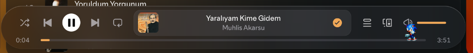
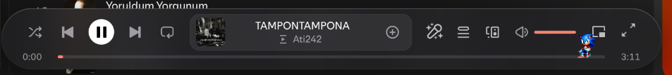

# Hide Default Lyrics

A [Spicetify](https://spicetify.app) extension for people who use [Spicy Lyrics](https://github.com/Spikerko/spicy-lyrics):
it keeps Spotify's own lyrics out of the way while Spicy Lyrics has the song's lyrics, and hides Spicy Lyrics' buttons
when it has none.

| Situation | What you see |
|---|---|
| Spicy Lyrics has the lyrics | Spotify's lyrics button and the Now Playing lyrics preview are hidden |
| Spicy Lyrics has none, Spotify does | Spicy Lyrics' playbar buttons and card are hidden; Spotify's lyrics stay. I haven't tested it myself, but that's what Claude said lol |
| Neither has any | Both are hidden (Spotify disables its own button when it has none) |
| Spicy Lyrics isn't installed | Nothing changes |

## Screenshots

Spicy Lyrics has no lyrics for the song: its buttons are gone, and so is Spotify's (it has none either).



Spicy Lyrics has the lyrics: its buttons show, Spotify's own lyrics button is hidden.



## Install

### From the Marketplace

Open the **Marketplace** in Spotify, go to **Extensions**, search for **Hide Default Lyrics** and install it.

### Manually

1. Copy `hideDefaultLyrics.js` into your Spicetify `Extensions` folder (`spicetify path userdata` prints its parent;
   on Linux and macOS it is `~/.config/spicetify/Extensions`).
2. Enable it and apply:

   ```sh
   spicetify config extensions hideDefaultLyrics.js
   spicetify apply
   ```

   If you already use other extensions, separate them with `|`:
   `spicetify config extensions "other.js|hideDefaultLyrics.js"`.

To remove it, take `hideDefaultLyrics.js` out of that list and apply again.

- Tested on Linux with Spotify 1.3.4.258, Spicetify 2.46.4 and the LiquidMusic theme.

## License

MIT
